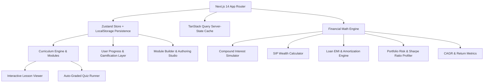

# Architectural Design & System Documentation

## 1. System Overview

**FinEdu Builder** is architected as a modular, client-first Next.js 14 application built with React 18, TypeScript, and Tailwind CSS. The system decouples educational content modeling, financial calculation engines, quiz evaluation, progress tracking, and authoring capabilities into distinct, cohesive layers.



---

## 2. Directory Structure

```
financial-education-builder/
├── app/
│   ├── favicon.ico
│   ├── globals.css              # Tailwind base, dark mode tokens & glassmorphism utilities
│   ├── layout.tsx               # Root layout with SEO meta and font configuration
│   └── page.tsx                 # Main application dashboard & view orchestrator
├── components/
│   ├── achievements/
│   │   └── AchievementsView.tsx # Badges, leveling rankings, and study stats
│   ├── builder/
│   │   └── ModuleBuilder.tsx    # Admin/Authoring studio for creating curriculum & quizzes
│   ├── calculators/
│   │   └── CalculatorsView.tsx  # 5 interactive financial calculation tools
│   ├── charts/
│   │   ├── InteractiveGrowthChart.tsx # Responsive SVG area/line growth visualizer
│   │   └── PortfolioDonutChart.tsx    # Responsive SVG asset allocation donut chart
│   ├── dashboard/
│   │   └── DashboardView.tsx    # Main learning hub, stats, continue learning widget
│   ├── lesson/
│   │   └── LessonViewer.tsx     # Interactive lesson reader, inline sandboxes, notes
│   ├── modules/
│   │   └── ModulesView.tsx      # Curriculum catalog, search, and category/level filtering
│   ├── quiz/
│   │   └── QuizRunner.tsx       # Auto-graded quiz engine with confetti and explanations
│   ├── search/
│   │   └── CommandPalette.tsx   # Ctrl+K instant command menu and search dialog
│   └── ui/
│       ├── Navbar.tsx           # Top navigation bar with XP badge, streak, and timer
│       ├── Sidebar.tsx          # Sidebar menu with progress summary
│       └── ToastContainer.tsx   # Animated XP and badge unlock notification popups
├── lib/
│   ├── badges.ts                # 12 badge definitions, unlock rules, and XP rank formulas
│   ├── defaultModules.ts        # 9 preloaded curated financial education modules
│   ├── financialMath.ts         # Pure mathematical calculation functions
│   └── store.ts                 # Zustand store with persistence middleware
├── types/
│   └── index.ts                 # TypeScript interfaces and data models
├── __tests__/
│   ├── components.test.tsx      # RTL component rendering and search tests
│   ├── financialMath.test.ts    # Financial formula unit tests
│   ├── quizScoring.test.ts      # Quiz evaluation & score threshold tests
│   └── storeProgress.test.ts    # Store, progress, and authoring integration tests
├── ARCHITECTURE.md              # Architectural documentation
├── README.md                    # Project overview and setup instructions
├── package.json
├── tailwind.config.ts
└── tsconfig.json
```

---

## 3. Core Architectural Modules

### 3.1 State Management & Persistence (`lib/store.ts`)
- **Zustand with LocalStorage Sync**: Client state is managed with `zustand` and the `persist` middleware. The store synchronizes:
  - `modules`: Preloaded modules + custom authoring additions.
  - `progress`: Completed lesson IDs, module completion flags, best quiz scores, XP count, active daily streak, total study time, bookmarks, and user lesson notes.
  - `darkMode`: Boolean theme flag with class binding.

### 3.2 Financial Mathematical Model (`lib/financialMath.ts`)
All calculations are pure, deterministic functions without side effects:
1. **Compound Interest with Monthly Deposits**:
   $$A = P \left(1 + \frac{r}{n}\right)^{nt} + PMT \times \left[ \frac{\left(1 + \frac{r}{n}\right)^{nt} - 1}{\frac{r}{n}} \right]$$
2. **Inflation Adjustment (Real Value)**:
   $$\text{Real Value} = \frac{\text{Nominal Value}}{(1 + i)^t}$$
3. **Loan EMI (Equated Monthly Installment)**:
   $$\text{EMI} = \frac{P \times r \times (1+r)^n}{(1+r)^n - 1}$$
4. **CAGR (Compound Annual Growth Rate)**:
   $$\text{CAGR} = \left( \frac{\text{Final Value}}{\text{Initial Value}} \right)^{\frac{1}{t}} - 1$$
5. **Sharpe Ratio**:
   $$\text{Sharpe Ratio} = \frac{R_p - R_f}{\sigma_p}$$
6. **Rule of 72**:
   $$\text{Years to Double} \approx \frac{72}{r}$$

### 3.3 Gamification Engine (`lib/badges.ts`)
The gamification system is triggered automatically on every action:
- **XP Progression**:
  - Completing a lesson: `+50 XP`
  - Passing a quiz (first time): `+75 XP`
  - Scoring 100% on a quiz: `+50 XP`
  - Creating a custom module: `+100 XP`
- **Level Tier Scaling**:
  - Level 1: *Novice Investor* (0 - 200 XP)
  - Level 2: *Finance Apprentice* (200 - 500 XP)
  - Level 3: *Market Strategist* (500 - 1000 XP)
  - Level 4: *Portfolio Architect* (1000 - 1800 XP)
  - Level 5: *Chief Financial Officer* (1800 - 3000 XP)
  - Level 6: *Legendary Fund Manager* (3000+ XP)
- **12 Unlockable Badges**: Monitored reactively by `checkAndAwardBadges()` in store.

---

## 4. Module Authoring System (Creator Studio)

The Module Builder allows creators to author complete interactive courses:
- **Lesson Ordering**: Drag or up/down ordering with atomic array updates.
- **Section Builder**: Supports markdown content, highlight callouts (*Key Takeaway*, *Pro Tip*, *Caveat*), and inline interactive calculators.
- **Quiz Authoring**: Multi-choice or True/False question creator with configurable correct answer index and post-submission explanations.
- **Data Portability**: Full JSON serialization allows exporting, backing up, and sharing educational modules across users.

---

## 5. Testing Strategy

The test suite consists of 4 main test suites:
1. `financialMath.test.ts`: Verifies exact mathematical correctness against edge cases (0 interest, long horizons, inflation adjustments).
2. `quizScoring.test.ts`: Verifies correct option grading, 70% passing threshold, retry mechanics, and best score tracking.
3. `storeProgress.test.ts`: Verifies lesson marking, full module completion detection, streak tracking, badge unlocks, and JSON serialization.
4. `components.test.tsx`: Verifies UI tab switching, slider changes, and Command Palette query matching.
